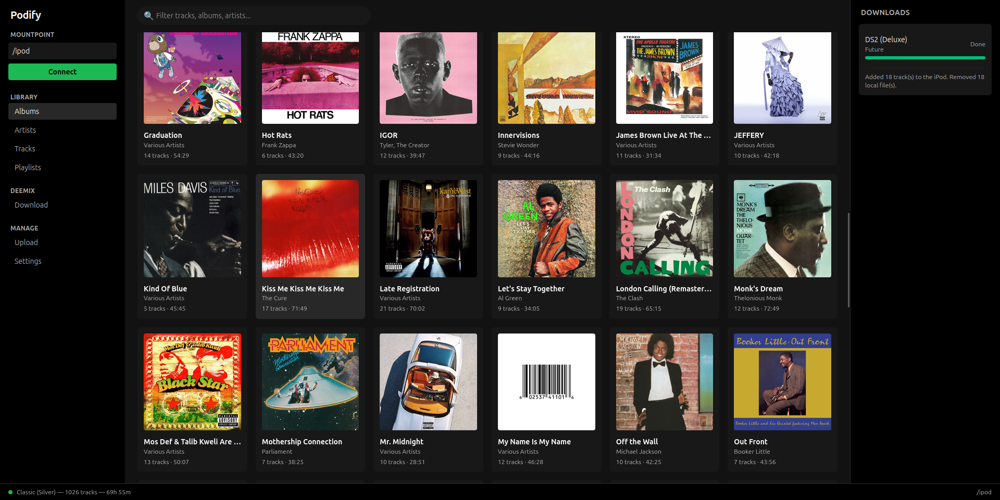

# Podify

Podify is a modern, Spotify-inspired web dashboard for browsing and managing music on an
**iPod Classic**. It pairs a React (Vite + TypeScript) single-page frontend with a Python/Flask
backend that talks to the iPod's iTunesDB via `gpod-utils`, and integrates
[deemix](https://gitlab.com/RemixDev/deemix-py) for searching and downloading music directly
into your library.

> Local-only tool. No authentication, no audio playback in the browser — it manages the device.



## Features

- **Library browsing** — tracks, artists, albums, and album art in a dark, Spotify-like UI.
- **Library management** — add/upload tracks and delete tracks.
- **Deemix integration** — search Deezer for tracks/albums/artists, drill into an artist's albums
  and an album's songs, and download at configurable quality (FLAC / MP3 320 / MP3 128).
- **Automatic pipeline** — downloads land in your Music Directory, FLAC is converted to ALAC, and
  files are copied onto the iPod via `gpod-cp`. Staged downloads are removed once they're on the device.
- **Discover** — album suggestions built from what's on your iPod, weighted by play counts. Add an
  album permanently, or on a timed trial that removes it from the device unless you keep it.
- **Auto-sync** — optionally scan the Music Directory and import new FLAC files when an iPod connects.

## Architecture

```
React (Vite/TS) frontend  ──►  Flask API (app.py)
                                 ├─ ipod_service.py      iPod DB read/write via gpod-utils
                                 ├─ album_art.py         album art extraction
                                 ├─ flac2alac_converter  FLAC → ALAC
                                 ├─ auto_sync.py         Music Directory → iPod
                                 ├─ deemix_routes.py     /api/deemix/* (deemix_service.py)
                                 └─ discover_routes.py   /api/discover/* (discover_service.py)
```

In production the frontend is built (`frontend/dist`) and served as static files by Flask.

## Run With Docker (recommended)

1. Mount your iPod on the host.
2. Create your environment file from the template and edit the paths:

   ```bash
   cp .env.example .env
   # edit .env: set IPOD_MOUNTPOINT and MUSIC_DIR_HOST
   ```

3. Build and start:

   ```bash
   sudo docker compose up --build -d --force-recreate
   ```

4. Open `http://localhost:8080`.
5. Enter mountpoint `/ipod` in the sidebar and click **Connect**.
6. In **Settings**, set the Music Directory to `/music`, and paste your Deezer ARL token to enable deemix.
7. Enable auto-sync if desired.

### Deezer ARL token (for deemix)

Downloading requires a Deezer ARL token. Add it in **Settings → Deezer ARL Token**. It is stored
server-side only (in `data/deemix_config.json`, which is gitignored) and never exposed back to the
frontend beyond a "configured" flag. **Never commit it.**

### Discover

**Discover → For you** suggests albums based on the iPod's library. Your artists are weighted by
how often you play them. Podify then walks Deezer's related-artist graph outward from them and uses
genre charts as wildcards. Suggestions need no ARL; downloading them does. Each card explains why
it was suggested.

The **Personalisation** dial sets how far from your library the suggestions go. All the way to
*Familiar* means albums you don't own yet by artists you already have. Further right moves to similar
artists, then artists two steps out, then genre charts. Releasing the dial re-rolls the batch, and
**New suggestions** re-rolls at the current setting.

Every suggestion can be added two ways:

- **Add** — copies the album onto the iPod permanently.
- **Try *N*d** — copies it on a trial (7 days by default). When the time is up the album is
  deleted from the iPod silently, unless you pressed **Keep**. Listening to it doesn't change the
  timer. If the iPod is unplugged when a trial ends, it's removed the next time the iPod is
  connected. **+7d** extends a trial by hand. A trial downloaded at a lower quality can be kept
  and re-downloaded in FLAC in one step.

Trials aren't limited to suggestions. The **Deemix** page has a **Try *N*d** button next to
**Download** for every album and song, at the quality picked there. Those trials show up under
**Discover → On trial** like any other. Artists can only be downloaded permanently.

A trial only removes the tracks it put on the device. Podify reads the library before and after the
download and records the new tracks that carry the album's tags. Before deleting, it checks that
each path still holds that title and album, so other music on the device is never touched.

**×** hides a suggestion for good, and **Never suggest** blocks an artist (undo that in
**Preferences**). Expired trials count as a mild "not for me" in later batches. Preferences also hold
the trial length and quality, the maximum number of trials at once, the batch size, whether EPs
are included, and an optional weekly refresh.

## Frontend development

The frontend lives in `frontend/`. For live development against a running backend:

```bash
cd frontend
npm install
npm run dev        # Vite dev server on http://localhost:5173, proxies /api to :8080
```

Build for production (what the Docker image runs):

```bash
npm run build      # outputs to frontend/dist
```

## Run Without Docker (Linux)

1. Install system dependencies:

   ```bash
   sudo apt-get update
   sudo apt-get install -y python3 python3-pip ffmpeg git autoconf automake libtool \
     build-essential pkg-config libglib2.0-dev libjson-c-dev libsqlite3-dev libgpod-dev \
     libavcodec-dev libavformat-dev libavutil-dev libswresample-dev libswscale-dev nodejs npm
   ```

2. Build and install `gpod-utils` (use this fork — its `gpod-ls` reports the artwork flag Podify expects):

   ```bash
   git clone --depth 1 https://github.com/MaxWilde/gpod-utils /tmp/gpod-utils
   cd /tmp/gpod-utils
   autoreconf --install && ./configure && make -j"$(nproc)" && sudo make install
   ```

3. Build the playlist helper:

   ```bash
   cd /path/to/Podify
   GPOD_PC=""; for C in gpod-1.0 libgpod libgpod-1.0 gpod; do pkg-config --exists "$C" && GPOD_PC="$C" && break; done
   gcc -O2 -Wall -Wextra -std=c11 $(pkg-config --cflags "$GPOD_PC" glib-2.0) \
     -o /usr/local/bin/gpod-playlistctl ./tools/gpod-playlistctl.c $(pkg-config --libs "$GPOD_PC" glib-2.0)
   ```

4. Install Python deps and build the frontend:

   ```bash
   python3 -m pip install -r requirements.txt
   cd frontend && npm install && npm run build && cd ..
   ```

5. Run the app:

   ```bash
   python3 app.py    # http://localhost:8080
   ```

## Environment variables

| Variable | Description | Default |
|----------|-------------|---------|
| `IPOD_MOUNTPOINT` | Host path where the iPod is mounted (→ `/ipod`) | `/media` |
| `MUSIC_DIR_HOST` | Host music/download directory (→ `/music`) | — (required) |
| `SETTINGS_DIR` | Host directory for persisted settings/state | `./data` |
| `HOST_IP` / `HOST_PORT` | Published bind address / port | `0.0.0.0` / `8080` |
| `APP_PORT` | Container port | `8080` |
| `DEEMIX_DOWNLOAD_SUBDIR` | Subfolder in `/music` for deemix downloads | `deemix` |
| `DISCOVER_STATE_PATH` | Discover preferences, suggestions and trial records | `.discover_state.json` |
| `DISCOVER_CACHE_PATH` | Cached Deezer lookups for suggestions | `.discover_cache.json` |
| `GUNICORN_THREADS` | Worker threads (single worker — see note) | `8` |

> The app runs as a **single gunicorn worker** because deemix job state is held in-process;
> concurrency is provided by threads instead.

## Tests

```bash
python3 -m unittest discover -s tests
```

## Credits

Built on [`gpod-utils`](https://github.com/whatdoineed2do/gpod-utils) and
[deemix](https://gitlab.com/RemixDev/deemix-py).
